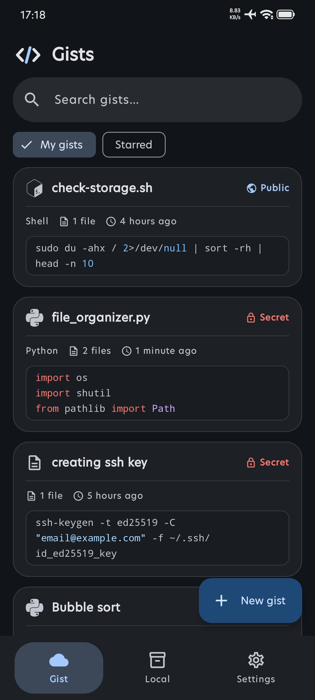
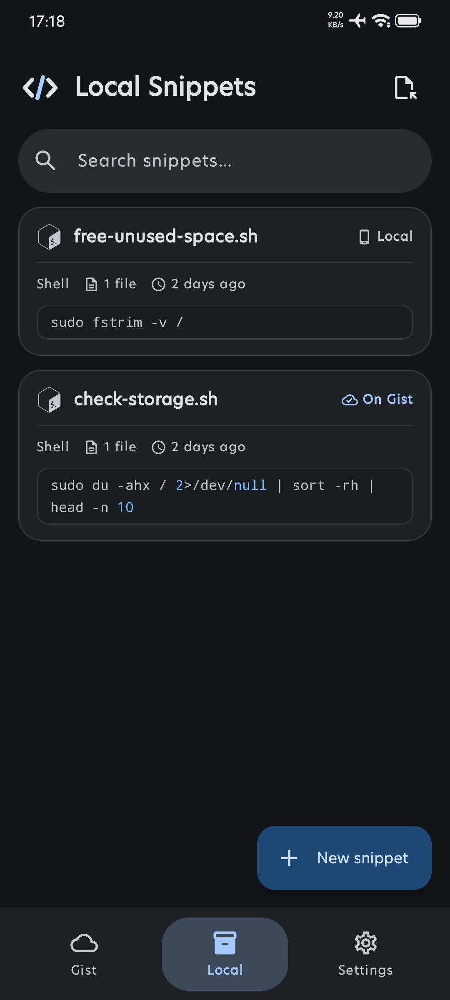
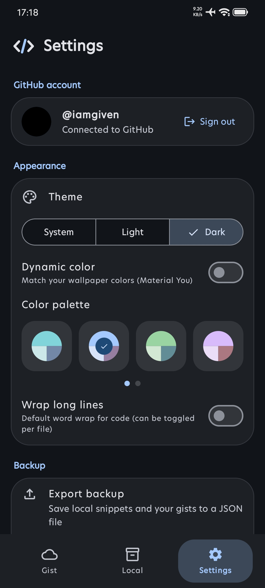

<p align="center">
  
</p>

<h1 align="center">GistDroid</h1>

[](https://github.com/iamgiven/GistDroid/actions/workflows/ci.yml)
[](https://github.com/iamgiven/GistDroid/releases/latest)
[](LICENSE)

A GitHub Gist client for Android, built with Jetpack Compose and Material 3. Keep your code snippets on
**GitHub Gist** or **locally** on your device, and move them between the two.

<p align="center">
  
  &nbsp;
  
  &nbsp;
  
</p>

## Features

- **Gists**: browse your own and starred gists, search, create, edit, delete, star and share them.
- **Local snippets**: stored on the device and usable without an account. Upload one to Gist at any time
  (choosing secret or public) and sync it again after editing.
- Save any gist as an offline local copy.
- Several files per gist or snippet: add, upload from the device, rename, reorder and remove them.
- Syntax highlighting, line numbers, word wrap and adjustable text size in the code viewer and editor.
- Language logos on list cards, picked from each file's language.
- Share text from any app to start a new snippet, or import code files.
- Back up local snippets and gists to a JSON file, and restore them.
- Material You dynamic color, six built-in color palettes, and light and dark themes.

## Install

Download the APK from the [latest release](https://github.com/iamgiven/GistDroid/releases/latest), or add
this repository to [Obtainium](https://github.com/ImranR98/Obtainium) to get updates.

Requires Android 8.0 (API 26) or newer.

Release APKs are signed with this certificate (SHA-256 fingerprint), also listed in every release with the
APK checksums:

```
67:FE:14:CA:E8:1E:BA:1A:99:B8:5A:F1:6A:01:78:D5:36:FE:BD:B3:4F:31:21:24:08:CC:E5:37:3E:23:2B:CD
```

You can check it with `apksigner verify --print-certs GistDroid-x.y.z.apk`, or let Obtainium or
[AppVerifier](https://github.com/soupslurpr/AppVerifier) compare it for you.

## Sign-in and token security

GistDroid uses a **personal access token**. Create a *classic* token with the `gist` scope at
<https://github.com/settings/tokens/new?scopes=gist&description=GistDroid> (or a fine-grained token with the
*Gists: read and write* permission) and paste it in **Settings**.

How the token is protected:

- It is checked against the GitHub API before it is saved; classic tokens without the `gist` scope are rejected.
- It is encrypted with AES-256-GCM using a non-exportable key in the **Android Keystore**, then stored in
  app-private storage.
- Backups and device-to-device transfer of app data are disabled.
- It is only sent to `api.github.com` over HTTPS; cleartext traffic is disabled.
- The token field blocks screenshots and screen recording, disables keyboard learning and is never kept in
  saved state; the clipboard is cleared after a successful paste.
- Signing out deletes the token and the Keystore key.

## Privacy

GistDroid has no analytics, ads or tracking, and connects only to GitHub. See [PRIVACY.md](PRIVACY.md).

## Building

You need JDK 17 and the Android SDK (or Android Studio).

```bash
./gradlew assembleDebug
```

The APK is written to `app/build/outputs/apk/debug/`. See [CONTRIBUTING.md](CONTRIBUTING.md) for more.

## Contributing

Bug reports, ideas and pull requests are welcome. Please read [CONTRIBUTING.md](CONTRIBUTING.md) and the
[Code of Conduct](CODE_OF_CONDUCT.md). To report a security issue, see [SECURITY.md](SECURITY.md).

## Support

If GistDroid is useful to you, you can support its development on
[Ko-fi](https://ko-fi.com/iamgiven).

## License

GistDroid is free software: you can redistribute it and/or modify it under the terms of the
[GNU General Public License](LICENSE) as published by the Free Software Foundation, either version 3 of the
License, or (at your option) any later version.

Language logos come from [Simple Icons](https://simpleicons.org) (CC0 1.0); see
[THIRD_PARTY_NOTICES.md](THIRD_PARTY_NOTICES.md).

GistDroid is not affiliated with or endorsed by GitHub, Inc. GitHub and Gist are trademarks of GitHub, Inc.
Language logos are trademarks of their respective owners.
